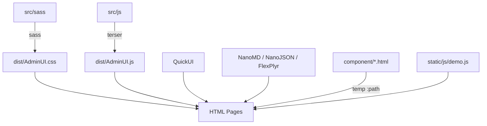

Last updated: 2026-10-25

> [!NOTE]
> This README was generated by [SKILL](https://github.com/agenvoy/skill-readme-generate), get the ZH version from [here](./doc/README.zh.md).

***

<strong>SHIP A CLEAN ADMIN PANEL WITHOUT DESIGNING ONE!</strong>

***

> A JavaScript admin panel template with a prebuilt SCSS layout, live input validation, and backend-free static demo pages

## Table of Contents

- [Features](#features)
- [Architecture](#architecture)
- [License](#license)
- [Author](#author)

## Features

> `npm install @pardnchiu/adminui` · [Documentation](./doc/doc.md)

- **Ready-Made Admin Layout** — A collapsible sidebar, a mobile top bar, and page styles for data lists, data editors, articles, folders, media, and text work as soon as you apply the matching classes.
- **Declarative Input Validation** — `data-type`, `data-max`, and `data-min` attributes declare the rules, and `textInput` filters input live while flagging account, number, email, password, and length errors.
- **Integrated Editors and Viewers** — QuickUI renders the views, while NanoMD, NanoJSON, and FlexPlyr provide Markdown, JSON, and media viewing.
- **Backend-Free Static Demo** — Eight demo pages cover data lists, editors, file management, media, Markdown, text, and JSON, share sidebar, nav, and login components through QuickUI `<temp :path>`, and run on any static server.
- **HSB Color System** — The Sass `hsb()` function builds nine-step palettes from hue, saturation, and brightness, so one hue value swaps the whole theme.

## Architecture

> [Full Architecture](./doc/architecture.md)

## License

This project is licensed under the [MIT LICENSE](LICENSE).

## Author

Just [open an issue](https://github.com/pardnchiu/AdminUI/issues/new) to share an idea.

***

©️ 2024 [邱敬幃 Pardn Chiu](https://www.linkedin.com/in/pardnchiu)
