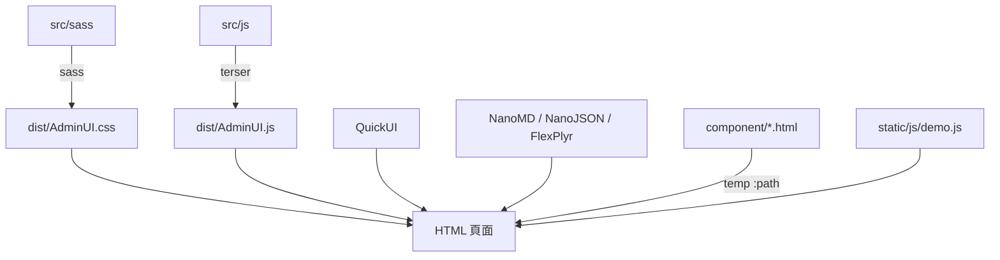

最後更新：2026-10-25

> [!NOTE]
> 此 README 由 [SKILL](https://github.com/agenvoy/skill-readme-generate) 生成，英文版請參閱 [這裡](../README.md)。

***

<strong>SHIP A CLEAN ADMIN PANEL WITHOUT DESIGNING ONE!</strong>

***

> JavaScript 後台管理模板，具備預建 SCSS 版面、即時輸入驗證與免後端靜態範例頁

## 目錄

- [功能特點](#功能特點)
- [架構](#架構)
- [授權](#授權)
- [Author](#author)

## 功能特點

> `npm install @pardnchiu/adminui` · [完整文件](./doc.zh.md)

- **現成後台版面** — 可收合側邊欄、行動版頂部導覽列，以及資料列表、資料編輯、文章、資料夾、媒體、文字等頁面樣式，只需套上對應 class 即可使用。
- **宣告式輸入驗證** — 以 `data-type`、`data-max`、`data-min` 等屬性宣告規則，`textInput` 即時過濾並標示帳號、數字、Email、密碼與長度錯誤。
- **整合編輯與檢視器** — 以 QuickUI 渲染畫面，並搭配 NanoMD、NanoJSON、FlexPlyr 提供 Markdown、JSON 與影音檢視。
- **免後端靜態範例** — 八個範例頁涵蓋資料列表、編輯器、檔案管理、媒體、Markdown、文字與 JSON，透過 QuickUI `<temp :path>` 共用側邊欄、導覽列與登入元件，任一靜態伺服器即可執行。
- **HSB 色彩系統** — Sass `hsb()` 函式以色相、飽和度、明度產生九階配色，改一個色相值即可換整套主題。

## 架構

> [完整架構](./architecture.zh.md)

## 授權

本專案採用 [MIT LICENSE](../LICENSE)。

## Author

Just [open an issue](https://github.com/pardnchiu/AdminUI/issues/new) to share an idea.

***

©️ 2024 [邱敬幃 Pardn Chiu](https://www.linkedin.com/in/pardnchiu)
