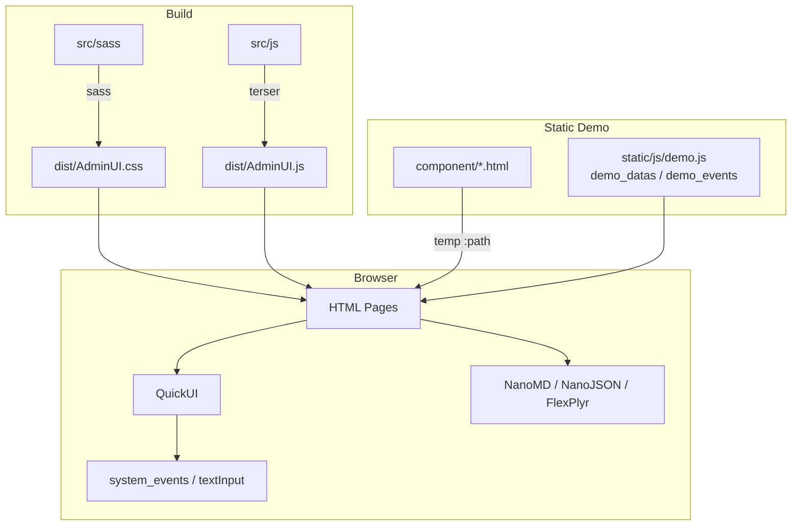
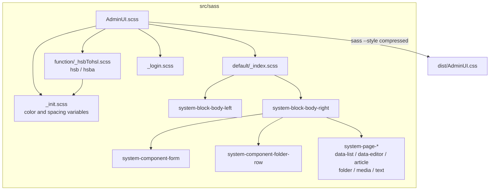
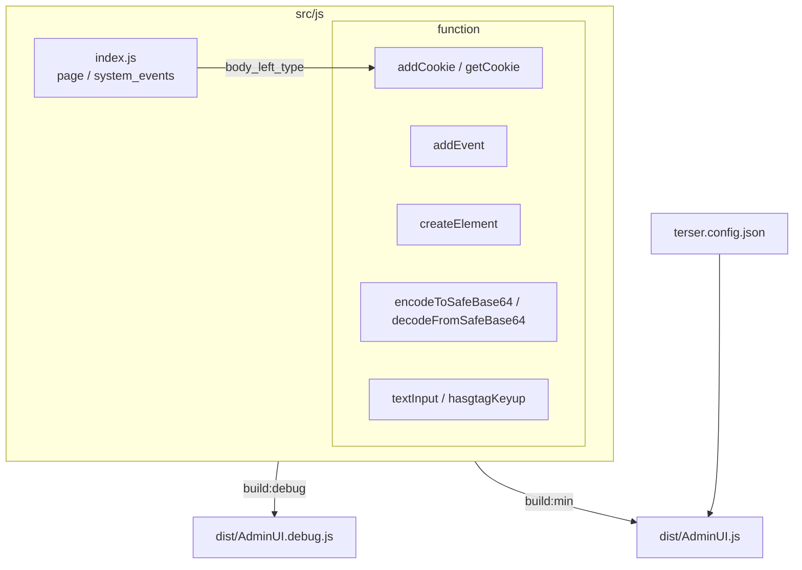
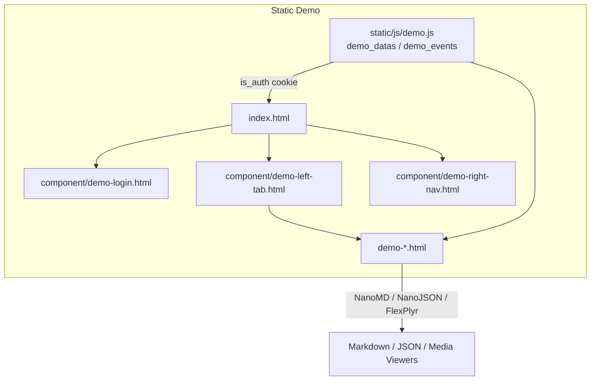
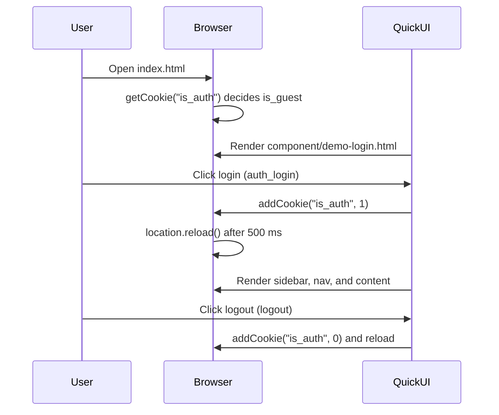
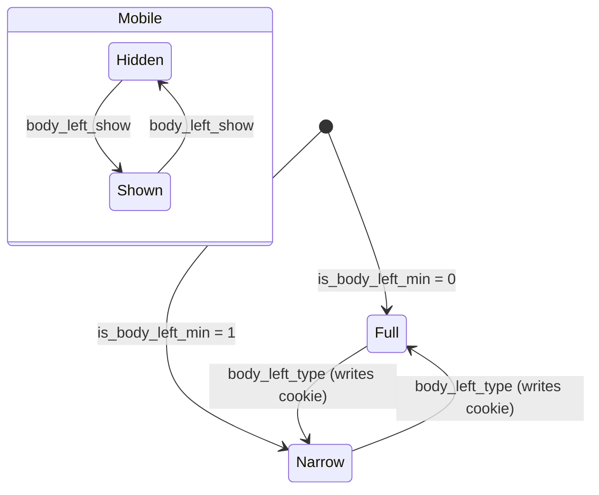

# AdminUI - Architecture

Last updated: 2026-10-25

> Back to [README](../README.md)

## Overview


```

## Module: Styles (src/sass)

`AdminUI.scss` is the single entry point; it imports the default layout and login styles inside the `body` scope and compiles to `dist/AdminUI.css`.



## Module: Scripts (src/js)

Terser concatenates `src/js/*.js` and `src/js/**/*.js` into one file, and every function is global.



## Module: Static Demo (index.html, demo-*.html, component/, static/)

Backend-free showcase pages that load shared components through QuickUI `<temp :path>`; `static/js/demo.js` supplies mock data and cookie login.



## Data Flow

### Static Demo Login



## State Machine

### Sidebar



***

©️ 2024 [邱敬幃 Pardn Chiu](https://www.linkedin.com/in/pardnchiu)
