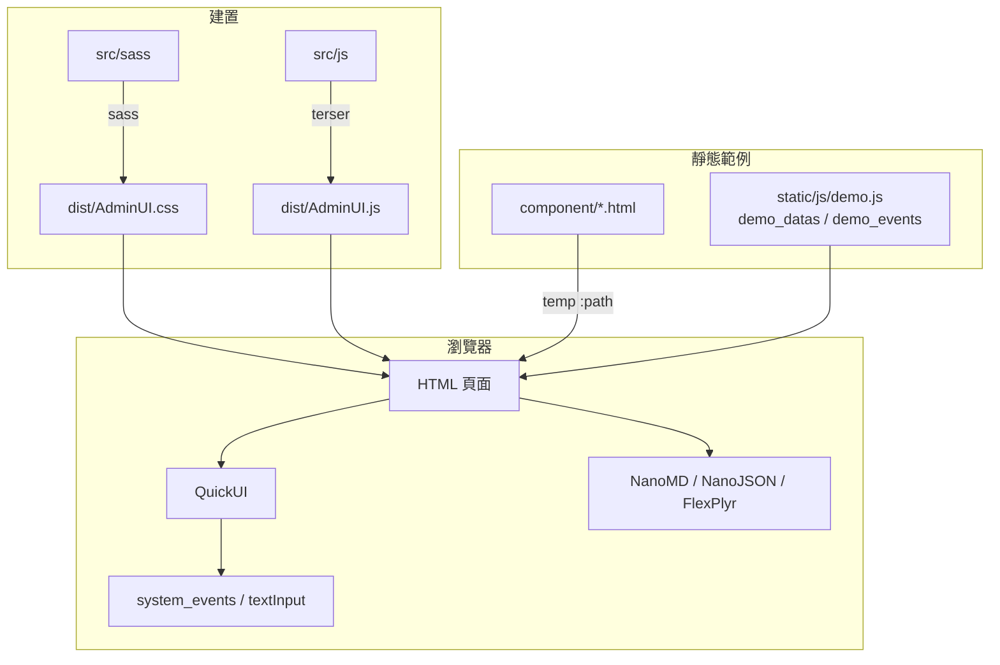
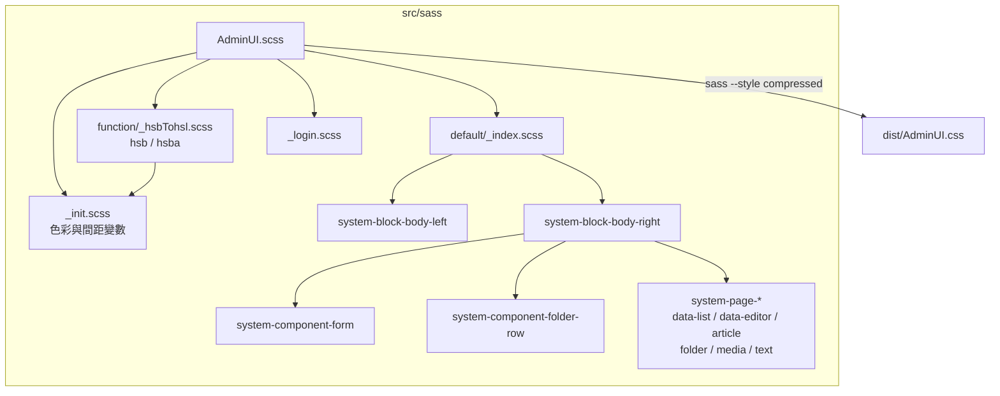
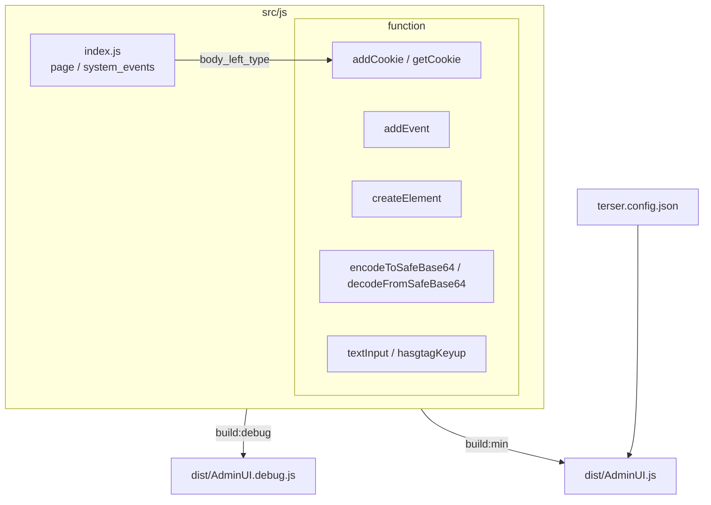
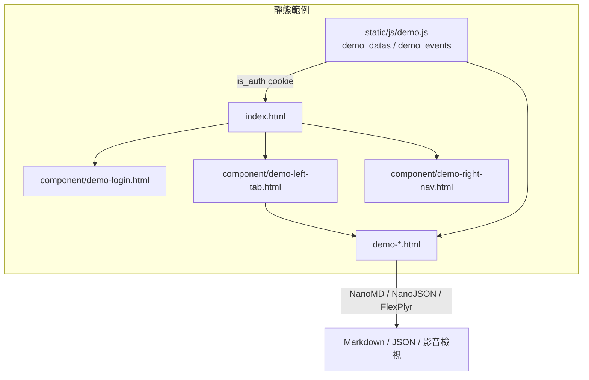
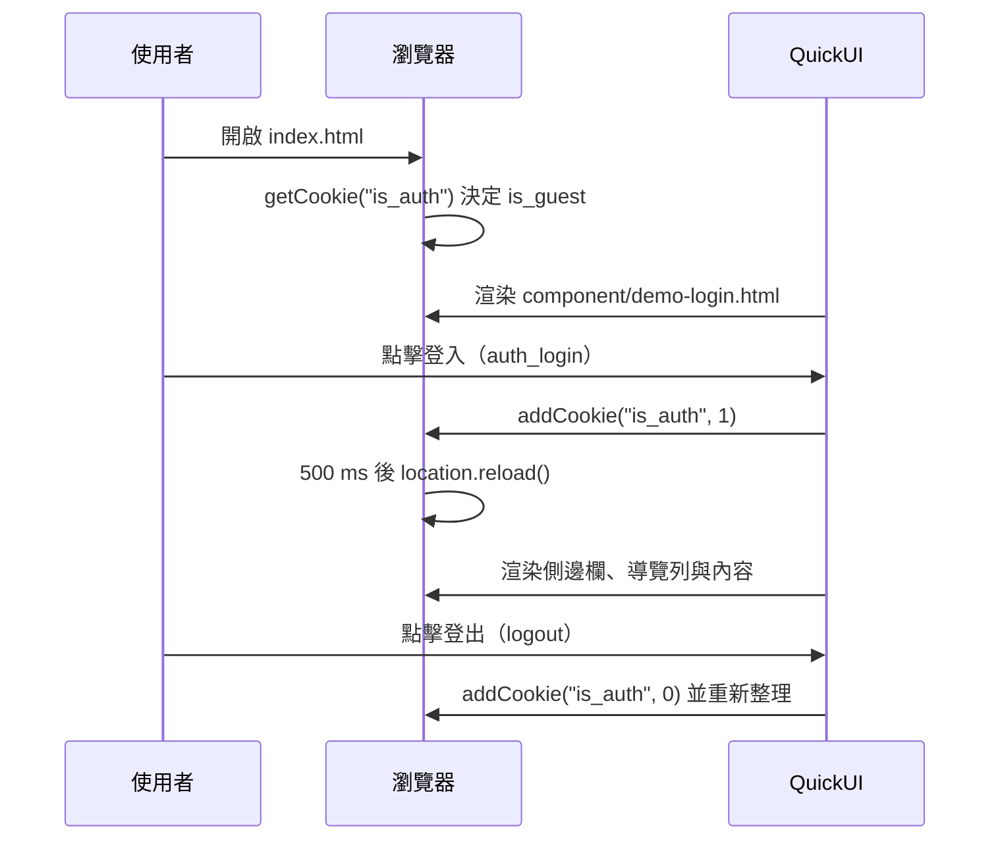
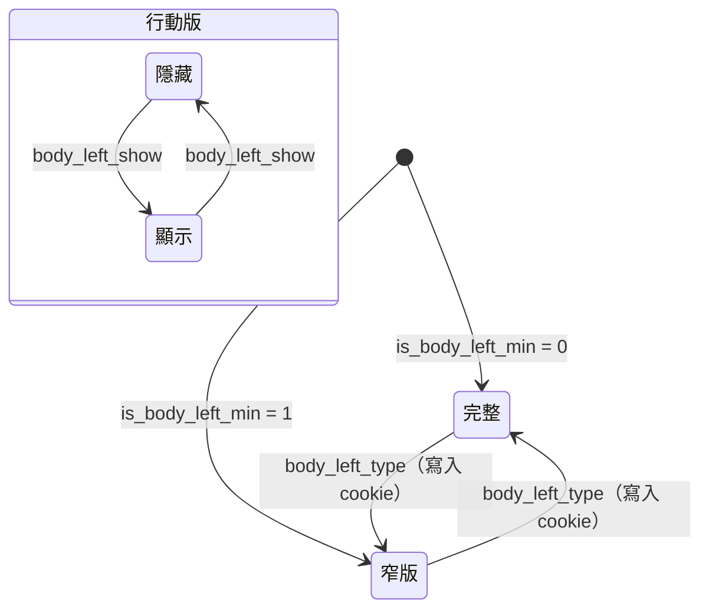

# AdminUI - 架構

最後更新：2026-10-25

> 返回 [README](./README.zh.md)

## 概覽


```

## 模組：樣式（src/sass）

`AdminUI.scss` 為唯一入口，在 `body` 範圍內匯入預設版面與登入樣式，編譯為 `dist/AdminUI.css`。



## 模組：腳本（src/js）

`src/js/*.js` 與 `src/js/**/*.js` 由 terser 合併為單一檔案，所有函式皆為全域。



## 模組：靜態範例（index.html、demo-*.html、component/、static/）

不需後端即可瀏覽的展示頁，以 QuickUI `<temp :path>` 載入共用元件，`static/js/demo.js` 提供假資料與 cookie 登入。



## 資料流

### 靜態範例登入



## 狀態機

### 側邊欄



***

©️ 2024 [邱敬幃 Pardn Chiu](https://www.linkedin.com/in/pardnchiu)
